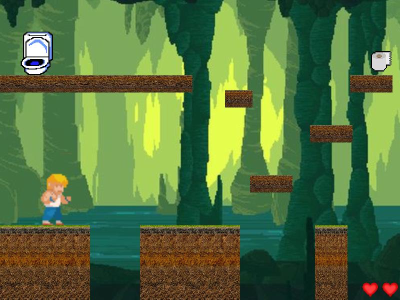

# phaser-simon

A small platformer I built for my nephews while learning Phaser 3. Simon has to reach the toilet, but only after picking up the toilet paper on the way.

### 🎮 [Live demo](https://pcolina.github.io/phaser-simon/)



## Features

- Title screen with a retro bitmap font and a controls screen
- One platformer stage with arcade physics, solid ground and one-way platforms you can jump through from below
- Animated player character (idle, walk, jump)
- Item pickup: the toilet only finishes the stage once you have the paper
- Three lives, falling into the water costs one, and Game Over with restart (Space)
- Pause / resume with P
- Background music and sound effects for jumping, dying, picking up the paper and winning

## Tech stack

- **Phaser** (^3.80.1): game framework (scenes, arcade physics, animations, audio)
- **Vite** (^5.2.12): dev server and production build

## Requirements

- Node.js installed on your machine.

## Installation

1. Clone this repository:

   ```
   git clone https://github.com/pcolina/phaser-simon.git
   ```

2. Navigate to the project directory:

   ```
   cd phaser-simon
   ```

3. Install dependencies:

   ```
   npm install --legacy-peer-deps
   ```

## Usage

Start the development server and open the game in your browser:

```
npm run dev -- --open
```

## How to Play

- **← →**: move
- **↑**: jump
- **P**: pause / resume
- **Space**: restart after Game Over

Grab the toilet paper and make it to the toilet without falling into the water.

## Credits

The project started from [ManzDev's Phaser 3 simple template](https://github.com/ManzDev/phaser3-simple-template), which provides the Vite and lint configuration and an empty scene. Everything on top of it is my own work: the title and controls screens, the stage and its platforms, the player controls and animations, the paper and toilet logic, lives, Game Over, pause, and sound.

- Built with [Phaser](https://phaser.io/).
- Player sprite sheet from the [Phaser examples](https://labs.phaser.io/).
- Additional assets from [OpenGameArt.org](https://opengameart.org/).

## License

This project is licensed under the MIT License - see the [LICENSE](LICENSE) file for details.
